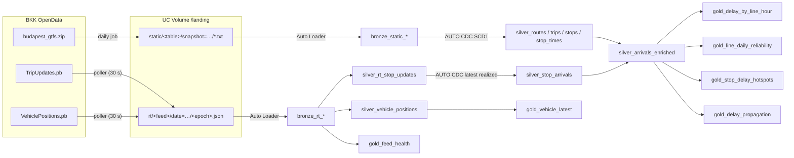

# Futár Lake 🚋

**How late is Budapest, really, and when?**
A Databricks lakehouse pipeline over Budapest's public transport data: BKK's static
GTFS timetable plus its GTFS-Realtime (FUTÁR) feeds, ingested with Auto Loader, cleaned and
deduplicated in silver, and turned into reliability metrics in gold.



## What's in each layer

| Layer | Table | Grain | Notes |
|---|---|---|---|
| bronze | `bronze_static_{routes,trips,stops,stop_times}` | row × snapshot | Every published timetable kept; strings only; BOM-safe headers |
| bronze | `bronze_rt_trip_updates` | trip × feed snapshot | Explicit schema, `_rescued_data` for anything off-contract |
| bronze | `bronze_rt_vehicle_positions` | vehicle × feed snapshot | |
| silver | `silver_routes/trips/stops/stop_times` | natural key | AUTO CDC SCD1 sequenced by snapshot → latest version, old trips retained |
| silver | `silver_rt_stop_updates` | trip × stop × snapshot | All predictions, with `is_realized` flag |
| silver | `silver_stop_arrivals` | service_date × trip × stop | Last *realized* observation per stop visit |
| silver | `silver_arrivals_enriched` | same | Joined to schedule, line, stop; `delay_s`, `delay_source`, `hour_local` |
| gold | `gold_delay_by_line_hour` | line × weekday/weekend × hour | avg / p50 / p90 delay, on-time share, >5 min late share |
| gold | `gold_line_daily_reliability` | service_date × line | daily scorecard |
| gold | `gold_stop_delay_hotspots` | stop | for a map; min-observation threshold |
| gold | `gold_delay_propagation` | line × direction × stop bucket | how delay builds along a route |
| gold | `gold_feed_health` | feed × hour | snapshots, entities, landing lag, off-contract rows |
| gold | `gold_vehicle_latest` | vehicle | live map source |

## Design decisions worth talking about

**Land first, then Auto Loader.** BKK serves protobuf over HTTP, which Auto Loader can't
read directly. A small poller writes one NDJSON file per snapshot into a Volume, named
by the feed's own header timestamp. Re-polling an unchanged feed writes nothing, so the
landing zone is idempotent and Auto Loader's exactly-once file tracking does the rest.
Files are written to a `.partial` name and renamed, so a half-written file is never picked up.
Raw `.pb` files are kept in `rt_raw/` for replay.

**The JSON contract is explicit.** `src/ingest/bkk_rt.py` decides the shape;
`transit_lib/schemas.py` declares it for the pipeline; a test asserts they match key-for-key.
Bronze reads with that schema (no inference), so a BKK feed change surfaces as
`_rescued_data` rows and an `on_contract` expectation count rather than a failed update.

**Predictions vs actuals.** Every poll re-reports every stop of every active trip:
future stops are *predictions*, past stops are *actuals*. A stop's arrival counts as
realized once its reported time is at or before the feed timestamp. `silver_stop_arrivals`
uses AUTO CDC keyed on `(service_date, trip_id, stop_sequence)` and sequenced by feed
time, so each stop visit ends up as one row holding the last realized value — ~25 raw
rows collapse into 1 on the sample data. The raw predictions stay in
`silver_rt_stop_updates`, which makes prediction-accuracy analysis possible (query 6 in
`sql/dashboard_queries.sql`).

**Two GTFS time traps, handled and tested.**
1. `stop_times` hours go past 24 (`25:13:00` = 01:13 the next morning, same service day).
2. GTFS times count from *noon minus 12 h*, not midnight. On the DST change days
   (in Budapest, the last Sundays of March and October) those differ by an hour, so `date + seconds`
   is wrong for every trip that day. `transit_lib/gtfs_time.py` does it properly and the
   tests pin it on 25 Oct 2026.

**Delay has two sources.** If the feed carries `arrival.delay`, use it; otherwise compute
`actual − scheduled` from the timetable. `delay_source` records which one, so you can
check how often each path is used on the real feed.

**Static timetable as SCD1, not "latest snapshot only".** BKK re-publishes the timetable
every few days and trip IDs churn. Keeping the latest version of every key across *all*
snapshots means yesterday's realtime events still find their schedule after a new feed lands.

**Pure functions, real tests.** All transformation logic lives in `src/pipeline/transit_lib`
(no pipeline imports), and `tests/local_runtime.py` is a small stand-in for the pipelines
runtime, so the actual `transformations/*.py` files run end-to-end on a laptop against a
synthetic BKK-shaped landing zone with known true delays. The tests assert the pipeline
recovers every delay exactly, across both delay paths, the DST day and after-midnight trips.

## Deploy to Databricks

Prereqs: a Unity Catalog workspace with serverless compute, the
[Databricks CLI](https://docs.databricks.com/dev-tools/cli/install.html), and a BKK API key.

1. **Get a BKK API key** at [opendata.bkk.hu](https://opendata.bkk.hu) (Key Management). The static GTFS needs no key; realtime does.
2. **Store it as a secret**
   ```bash
   databricks secrets create-scope bkk
   databricks secrets put-secret bkk api_key
   ```
3. **Set your catalog and alert email** in `databricks.yml` (or pass `--var catalog=…`).
4. **Deploy and run**
   ```bash
   databricks bundle validate
   databricks bundle deploy -t dev
   databricks bundle run bkk_static_daily -t dev       # land the timetable (~1-2 min)
   databricks bundle run bkk_realtime_poller -t dev    # collects for 55 min
   databricks bundle run bkk_transit_pipeline -t dev   # bronze → silver → gold
   ```

`-t dev` pauses all schedules (development mode), so nothing runs or costs money until
you start it. In `-t prod` the schedules are live: static daily at 04:31, the poller
hourly, the pipeline every 30 min.

**Cost note:** the poller is the only always-on piece (one serverless notebook, mostly
sleeping). Leave it running for a few days before reading too much into the hourly
delay numbers; a single hour of data is mostly noise.

## Run locally (no workspace needed)

```bash
python -m venv .venv && source .venv/bin/activate     # Python 3.10–3.12, Java 17+
pip install -r requirements-dev.txt
python scripts/run_local.py      # builds synthetic data, runs every layer, prints gold tables
pytest -q                        # 18 tests
python scripts/make_sample_landing.py ./sample_landing   # just the data, to inspect
```

The sample data uses real Budapest line numbers and stop names, but the timetable and
delays are synthetic.

## Project layout

```
databricks.yml                 bundle: variables, dev/prod targets
resources/
  storage.yml                  UC schema + landing volume
  pipeline.yml                 serverless Lakeflow pipeline
  jobs.yml                     static loader, realtime poller, pipeline refresh
src/ingest/
  bkk_rt.py                    HTTP client + protobuf → NDJSON decoder (pure, tested)
  load_static_gtfs.py          notebook: zip → landing/static (SHA-256 skip if unchanged)
  poll_realtime.py             notebook: poll every 30 s → landing/rt
src/pipeline/
  transit_lib/                 schemas, GTFS time math, labels, transforms (pure, tested)
  transformations/
    bronze.py silver.py gold.py
sql/dashboard_queries.sql      starter queries for an AI/BI dashboard
scripts/                       synthetic data generator, local runner
tests/                         unit + end-to-end tests, local pipelines runtime stub
```

## Notes and limits

- Pipeline code uses the current `pyspark.pipelines` API (`dp.table`,
  `dp.materialized_view`, `dp.create_auto_cdc_flow`). On older runtimes the
  equivalents are `dlt.table` and `dlt.apply_changes`.
- BKK also publishes a `gtfs-realtime-realcity` protobuf extension and an `Alerts.pb` feed;
  neither is used yet. Alerts would be a natural next bronze table.
- "On time" is −60 s…+180 s by default; change `bkk.on_time_*` in `resources/pipeline.yml`.
- The local runtime emulates AUTO CDC and Auto Loader as batch operations. It proves the
  logic and the graph, not streaming behaviour (checkpoints, late data); test that on a workspace.
- Data: BKK GTFS is published as open data; check the
  [BKK OpenData terms](https://opendata.bkk.hu) before publishing derived datasets.
